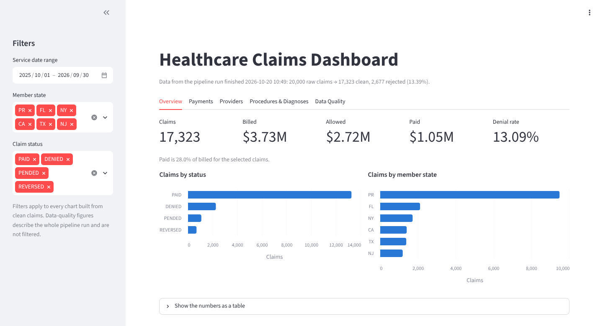
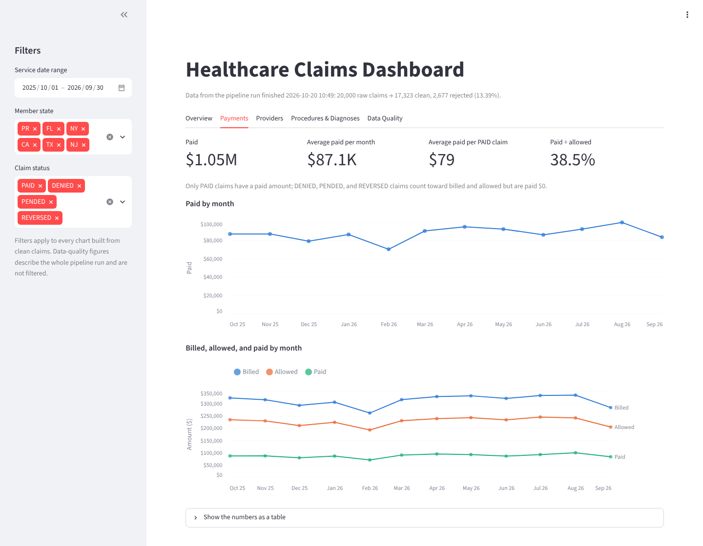
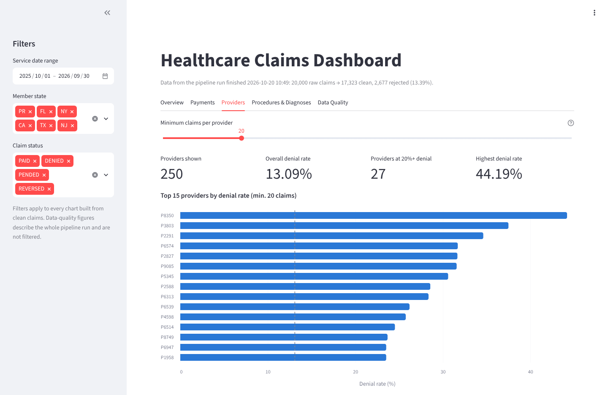

# Healthcare Claims Data Pipeline
 
An end-to-end data pipeline that generates synthetic healthcare claims data, cleans and validates it, loads it into PostgreSQL with a full audit trail, produces analytics-ready reports, and trains baseline fraud-detection models.
 
All data is synthetic. No real patient, member, or provider information is used.
 
## Tech Stack
 
- **Python**: pandas, NumPy, psycopg2, scikit-learn, matplotlib
- **PostgreSQL** (tested with version 18)
- **SQL**: schema, indexes, constraints, analytics views
- **PowerShell**: one-command pipeline runner
- **Dashboard**: Streamlit, Altair, SQLAlchemy


## Pipeline Overview
 
```
generate_raw_data.py   ->  data/raw/claims_raw.csv        (20,000 messy claims)
clean_transform.py     ->  data/clean/claims_clean.csv    (valid rows)
                           data/clean/claims_rejects.csv  (invalid rows + reason)
load_to_postgres.py    ->  claims_clean, claims_rejects, pipeline_runs
010_analytics_views    ->  monthly payments, denial rates, average paid by CPT
011 / 020              ->  quality checks and summary reports
012_dashboard_views    ->  views that feed the dashboard
app/dashboard.py       ->  Streamlit dashboard (5 tabs)
ml/                    ->  fraud labels -> features -> model training
```
 
1. **Generate** synthetic raw claims with deliberate problems: mixed date and money formats, missing values, inconsistent casing, and business-rule violations.
2. **Clean and validate** every row. Invalid rows are not dropped silently: each one is written to a rejects file with the reason it failed.
3. **Load** clean rows and rejects into PostgreSQL in one transaction. Each load is logged in `pipeline_runs` with its row counts and status (`SUCCESS` or `FAILED`), and every loaded row is tagged with its `run_id`.
4. **Reconcile**: the loader checks that raw rows = clean rows + rejected rows and stops if any row is unaccounted for.
5. **Enforce** data quality in the database itself with CHECK constraints (valid status, 2-letter state, non-negative amounts, paid ≤ allowed ≤ billed).
6. **Analyze** with SQL views, report queries, and an interactive dashboard (see [Dashboard](#dashboard)).
7. **Model** fraud with Logistic Regression and Random Forest baselines (see [Fraud Detection](#fraud-detection-in-progress)).

## Synthetic Data Design
 
The generator is seeded and uses a fixed service window, so every run produces the same dataset.
 
| Setting | Value |
|---|---|
| Raw claims | 20,000 |
| Service window | 2025-10-01 to 2026-09-30 (12 full months) |
| Providers | 250, with uneven claim volume; a small share deny claims more often |
| Procedures | 20 CPT codes, each with its own billed-amount range |
| Members | Mostly Puerto Rico (55%), plus FL, NY, CA, TX, NJ |
| Missing-field rate | 12% of rows |
| Rule-violation rate | 2% of rows |
| Paid amounts | Only PAID claims are paid; DENIED, PENDED, and REVERSED claims have $0 paid |
 
## Running the Pipeline
 
### 1. Set up the environment
 
```powershell
python -m venv .venv
.\.venv\Scripts\Activate.ps1
pip install -r requirements.txt
```
 
### 2. Run everything
 
```powershell
.\run_all.ps1           # full pipeline, including the ML stage
.\run_all.ps1 -SkipML   # data pipeline only
```
 
The script prompts for the Postgres password (or reads `PGPASSWORD`), creates the database if needed, and runs every step in order. It stops at the first failed step.
 
> The script expects PostgreSQL at `C:\Program Files\PostgreSQL\18\bin\`. Edit `$psql` and `$createdb` at the top of `run_all.ps1` if yours is elsewhere.
 
## Dashboard

An interactive Streamlit dashboard reads the PostgreSQL views directly.



<details>
<summary>More screenshots: Payments and Providers tabs</summary>





</details>

Run the pipeline first, then:

```powershell
# Hidden password prompt (the password is not saved in your shell history)
$env:DB_PASSWORD = [System.Net.NetworkCredential]::new("", (Read-Host "Postgres password" -AsSecureString)).Password
streamlit run app/dashboard.py
```

| Tab | What it shows |
|---|---|
| **Overview** | KPI tiles (claims, billed, allowed, paid, denial rate), claims by status and by member state |
| **Payments** | Paid by month; billed vs. allowed vs. paid by month; average paid per PAID claim and paid ÷ allowed |
| **Providers** | Top providers by denial rate (with a minimum-claims slider) and provider volume vs. denial rate |
| **Procedures & Diagnoses** | Average paid, claim volume, and denial rate by CPT code and by diagnosis |
| **Data Quality** | Row reconciliation, rejects by reason and by missing field, live checks on the loaded table, and the pipeline run history |

- **Filters:** the sidebar filters (date range, member state, claim status) apply to the first four tabs. Data Quality describes the whole pipeline run and is not filtered.
- **How it works:** filter values are passed to SQL as bind parameters, never pasted into the query text. Query results are cached for 10 minutes, so after re-running the pipeline use **⋮ → Clear cache** to see the new data.
- **Readability:** every chart has hover tooltips and a table view with the same numbers, and series are labeled directly, never by color alone.


## Results (current dataset)
 
**Row reconciliation**
 
| Raw | Clean | Rejected |
|---:|---:|---:|
| 20,000 | 17,323 | 2,677 |
 
**Reject reasons**
 
| Reason | Rows |
|---|---:|
| Missing required field(s) | 2,311 |
| Invalid status | 94 |
| Paid > allowed or allowed > billed | 93 |
| Invalid state code | 90 |
| Negative amount | 89 |
 
**Claim status**: PAID 76.6% · DENIED 13.1% · PENDED 6.3% · REVERSED 4.0%
 
**Example insights**
 
- Monthly paid amounts range from about **$70K to $99K** across the 12 months.
- Provider denial rates range from **0% to 44%**; **27 of 250** providers deny 20% or more of their claims.
- Average paid per claim varies widely by procedure, from lab work at the low end to colonoscopy and high-level emergency visits at the top.

## Fraud Detection (in progress)
 
The `ml/` folder extends the pipeline into machine learning.
 
1. `generate_fraud_labels.py` creates **synthetic** fraud labels from rules: a claim is labeled fraud when at least 2 of 3 signals are in the top 5% (billing ratio, provider claim volume, paid amount), plus a 1% random component. The current fraud rate is **1.66%**.
2. `feature_engineering.py` builds date and ratio features and drops identifiers.
3. `train_fraud_model.py` trains Logistic Regression (including a class-weight sweep) and Random Forest, runs a threshold sweep, and saves precision-recall and threshold charts to `ml/artifacts/`.

**Current baseline (test set, ROC AUC):** 
- Logistic Regression: 0.70
- Random Forest: 0.70

Because the labels are generated by rules, these scores measure how well each model recovers those rules, not real-world fraud detection performance. A dedicated evaluation script (`evaluate_model.py`) is planned.
 
## Project Structure
 
```
healthcare-claims-pipeline
│
├── python
│   ├── generate_raw_data.py      # synthetic messy claims
│   ├── clean_transform.py        # validation + rejects
│   └── load_to_postgres.py       # load, run logging, reconciliation
│
├── sql
│   ├── 001_schema.sql            # raw and clean tables
│   ├── 002_indexes.sql           # indexes for analytics queries
│   ├── 003_portfolio_upgrade.sql # pipeline_runs, claims_rejects, constraints
│   ├── 010_analytics_views.sql   # analytics views
│   ├── 011_quality_checks.sql    # post-load checks
│   ├── 012_dashboard_views.sql   # views that feed the dashboard
│   └── 020_report_queries.sql    # summary reports
│
├── app
│   └── dashboard.py              # Streamlit dashboard
│
├── ml
│   ├── generate_fraud_labels.py
│   ├── feature_engineering.py
│   ├── train_fraud_model.py
│   └── artifacts/                # saved charts
│
├── run_all.ps1
├── requirements.txt
└── README.md
```
 
## Concepts Demonstrated
 
- ETL pipeline design with separate raw, clean, and reject outputs
- Data validation, rejection handling, and row-level reconciliation
- Auditable loads (run logging and `run_id` lineage)
- Transactional loading with rollback on failure
- PostgreSQL schema design, indexing, and CHECK constraints
- SQL analytics views with minimum-sample-size filters
- Interactive dashboard with parameterized, cached SQL queries
- Imbalanced classification and threshold tuning
- One-command, fail-fast pipeline automation

## Author
 
Rosaliz V. Garcia
Computer Science, Data Science Track
 